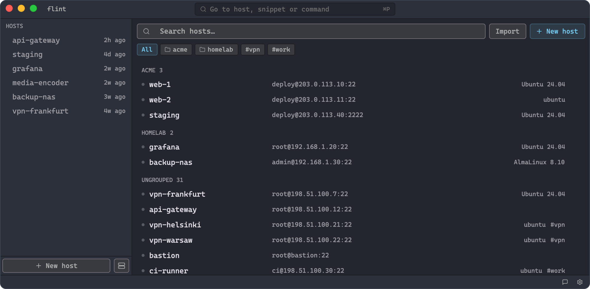
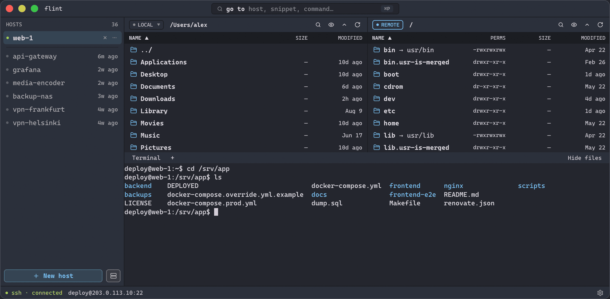

# flint

> [!WARNING]
> This is experimental software, primarily built with AI.

SSH and SFTP client for desktop. Terminal and file manager in one window, and your hosts and keys are stored in encrypted file on your disk. I made it for myself because I hate Electron.

It is written in Rust with [GPUI](https://www.gpui.rs/), the UI framework from Zed.





This is version 0.1.1 and I work on it alone. It works for me, but there are bugs for sure and many things are not done yet. Please don't expect too much.

## Download

https://flint.mouse.pw

- macOS, Apple silicon only. Signed and notarized.
- Windows x64. Not signed, so Windows will show a warning. I tested it much less than the Mac version.

For Linux and Intel Mac you need to build it yourself for now.

## What works

- SSH with password, private key or ssh agent. 2FA prompts work too.
- Jump hosts, SOCKS5 and HTTP proxy.
- Port forwarding: local, remote and dynamic.
- Terminal with tabs and search. It can suggest commands from shell history of the server.
- Two-panel file manager, local and remote, or two servers. Drag and drop works.
- Open a remote file in your local editor, it uploads back when you save (macOS and Windows).
- Snippets.
- Import from `~/.ssh/config`, and from PuTTY on Windows.
- Everything is kept in a vault with master password and a 24-word recovery phrase.

## Sync and teams

This part is optional. The app works without any account.

If you sign in with GitHub, your hosts sync between your devices. The data is encrypted on your machine before upload, so the server can't read it. Teams let you share hosts with other people by invite link.

I made the server for myself and my friends, so it is easier for us to keep hosts on all devices. The server code is not open and I run it myself. So here you have to trust me, or just don't use sync. What the server can see is described in [SECURITY.md](SECURITY.md).

Sync of your own hosts is free. Teams are free now too. But if a lot of people start to use the app, Teams will become paid. Only the owner of a team will pay, and only for the team itself. Members will not pay anything.

## Build

You need [rustup](https://rustup.rs/). The right toolchain installs itself on first build.

```sh
git clone https://github.com/mousEHEHE/flint-gpui
cd flint-gpui
cargo build --release --locked
```

Please keep `--locked`. Without it gpui can update and the build will break.

On Linux you also need some packages (names for Debian and Ubuntu):

```sh
sudo apt install build-essential clang cmake pkg-config \
  libfontconfig-dev libfreetype-dev libwayland-dev \
  libxkbcommon-dev libxkbcommon-x11-dev libx11-xcb-dev libxcb1-dev libvulkan1
```

## What is missing

- No agent forwarding, no X11 forwarding, no `ProxyCommand`.
- No local terminal and no split panes.
- No key generation, and `.ppk` keys are not supported.
- The vault does not lock by itself, only when you lock it.
- A stopped file transfer starts from the beginning.
- Updates are not signed. The app only tells you there is a new version and downloads the file, you install it yourself.
- Linux build is almost not tested.
- Nobody did a security audit of it.

Probably a lot of other things too. If something is broken, please open an [issue](https://github.com/mousEHEHE/flint-gpui/issues).

## Network

flint connects to `flint.mouse.pw` to check for updates (you can turn it off in settings) and for sync, if you use it. There is no telemetry.

## License

GPL-3.0. gpui uses some GPL code from Zed, so flint has to be GPL too. Other licenses are listed in [THIRD-PARTY.md](THIRD-PARTY.md).

If you found a security problem, please don't open a public issue, see [SECURITY.md](SECURITY.md).
